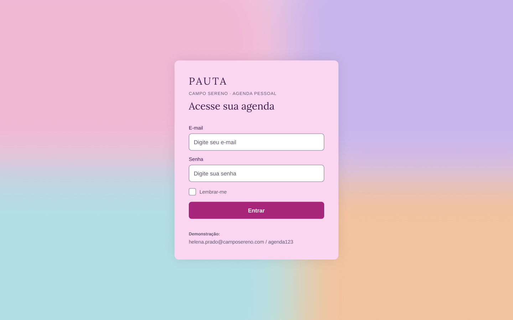
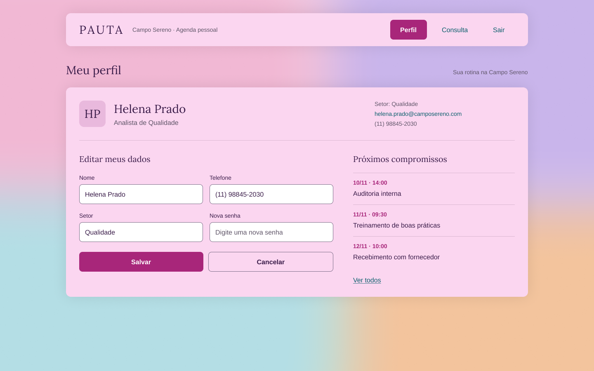
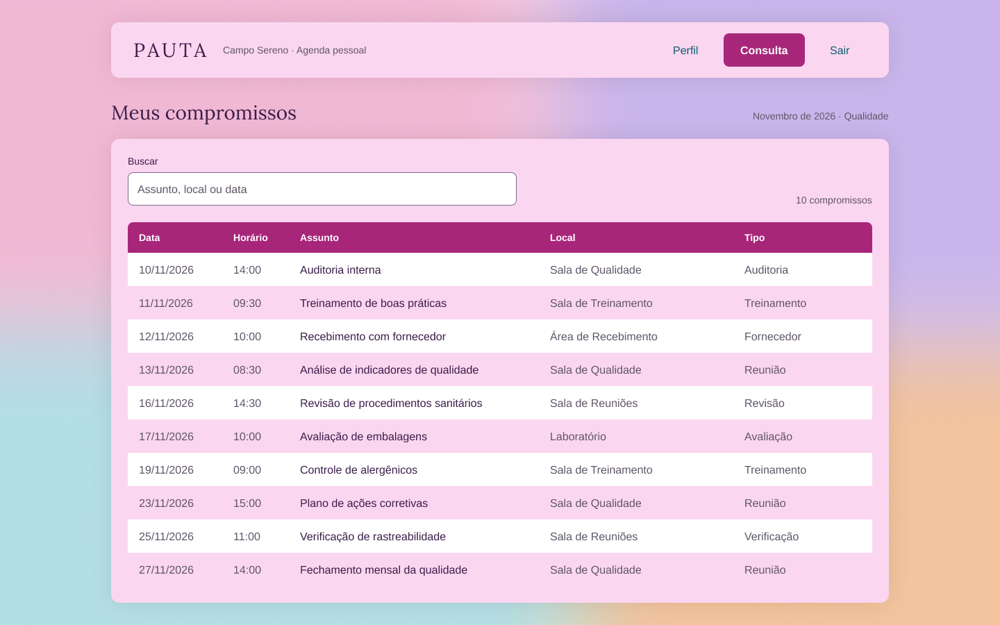
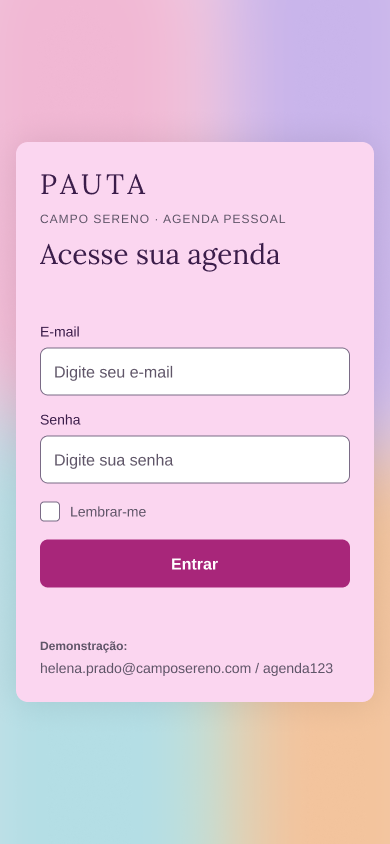
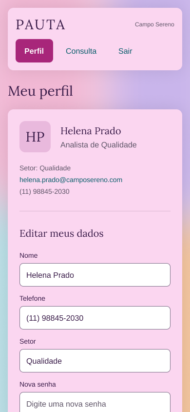
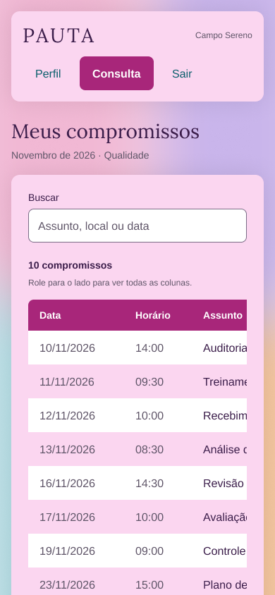

# PAUTA — Agenda pessoal Campo Sereno (SA02)

Front-end de uma agenda de compromissos de uma colaboradora de uma empresa de alimentos fictícia (Campo Sereno): **login**, **perfil** e **consulta** com tabela e campo de busca. Projeto individual da Situação de Aprendizagem 02, feito só com HTML, CSS externo e JavaScript.

- **Autora:** Raquel S.R. Duarte
- **Status:** concluído. HTML, CSS (incluindo o celular) e JavaScript prontos.

## Andamento
| Etapa | Situação |
|---|---|
| 1. Fundos em WebP | feito |
| 2. Estrutura HTML das 3 páginas | feito |
| 3. CSS do login: base, fundo e cartão | feito (13/11) |
| 4. CSS do login: campos, botão, hover e foco | feito (14/11) |
| 5. CSS do perfil | feito (15/11) |
| 6. CSS da consulta (busca, contador e tabela) | feito (15/11) |
| 7. Responsivo (celular, `@media`) | feito (15/11) |
| 8 e 9. JavaScript (login, proteção das páginas, Sair e edição do perfil com validação) | feito (17/11) |
| 10. Publicação no GitHub Pages | feito (17/11) |

## Telas
1. **Login** (`index.html`): e-mail, senha, "Lembrar-me", botão Entrar, mensagem de erro (escondida até precisar) e bloco de demonstração.
2. **Perfil** (`perfil.html`): menu, dados da colaboradora, formulário de edição com campos preenchidos e bloqueados (botões Salvar e Cancelar escondidos até clicar em Editar perfil) e próximos compromissos.
3. **Consulta** (`consulta.html`): menu, campo de busca, contador e tabela com 10 compromissos (Data, Horário, Assunto, Local e Tipo).

## Protótipo (Figma)
Imagens em `docs/prototipo-v2/`: login, perfil e consulta no desktop (1440 × 900) e no celular (390 × 844).

**Desktop**

| Login | Perfil | Consulta |
|---|---|---|
|  |  |  |

**Celular**

| Login | Perfil | Consulta |
|---|---|---|
|  |  |  |

## Como abrir
Online: https://duartelab.github.io/NovaWeb/

Local: 
abra `index.html` no navegador. Login de demonstração: `helena.prado@camposereno.com` / `agenda123`.

## Estrutura
```
index.html  perfil.html  consulta.html
css/style.css
js/app.js
imagens/        fundos em WebP
docs/           protótipo e decisões
```

## Imagens
| Arquivo | Dimensão | Formato | Peso |
|---|---|---|---|
| `imagens/fundo-desktop.webp` | 1920 × 1080 | WebP | 6 KB (PNG original: 52 KB) |
| `imagens/fundo-celular.webp` | 1080 × 1920 | WebP | 6 KB (PNG original: 59 KB) |

## Decisões
Registradas em `docs/decisoes.md`.
